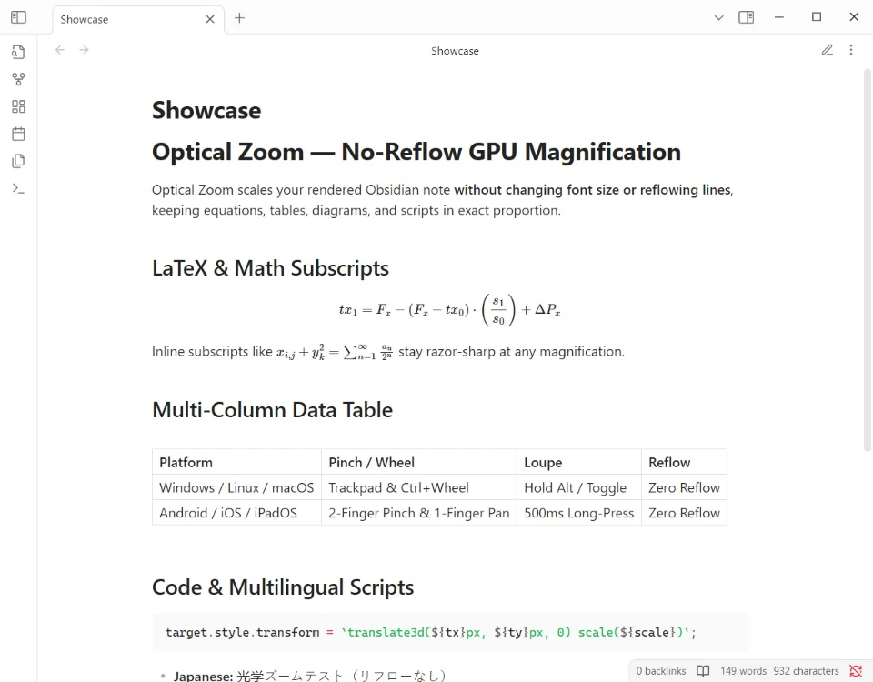
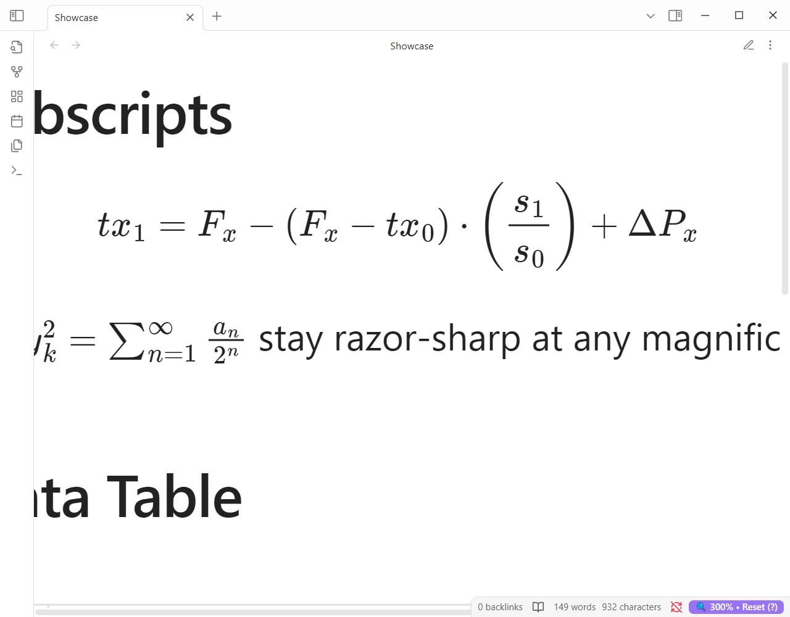
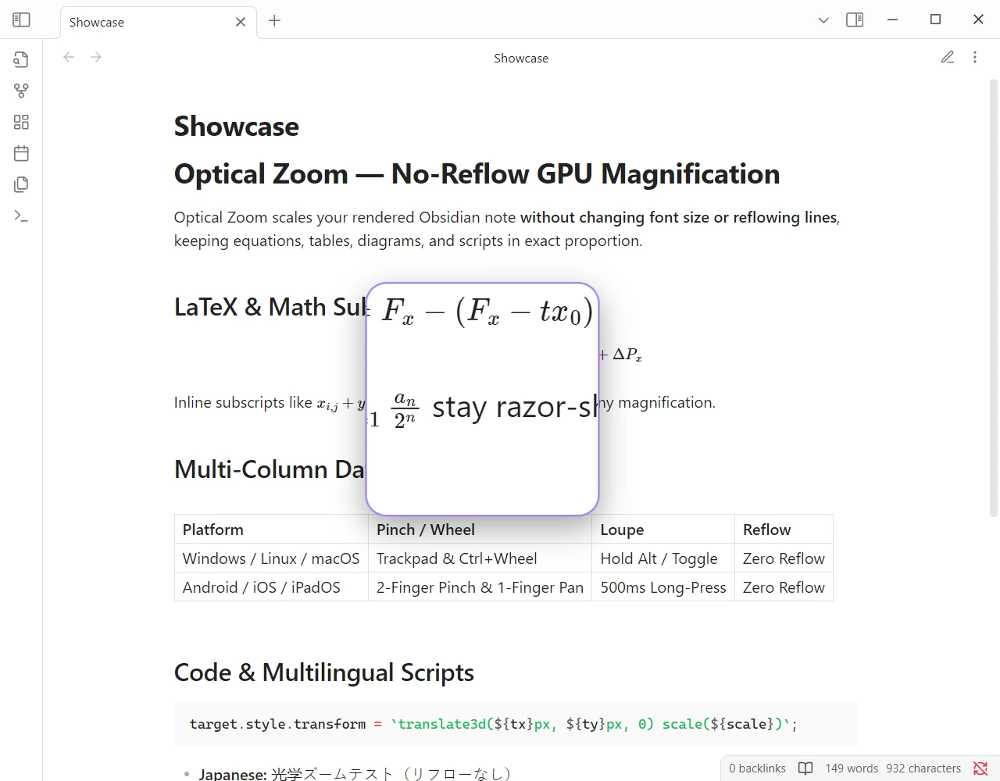
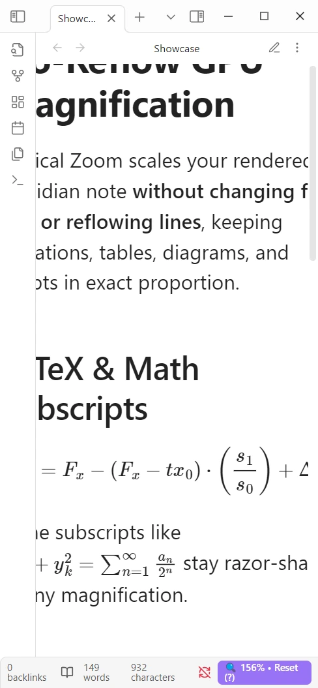
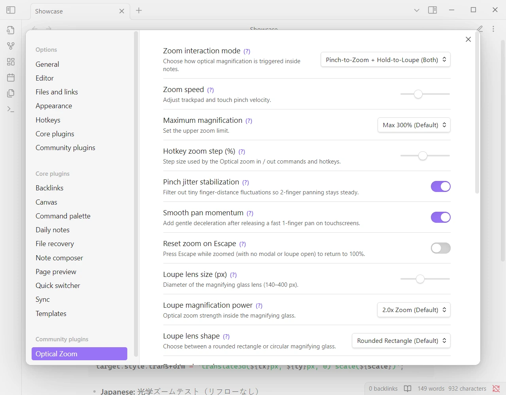
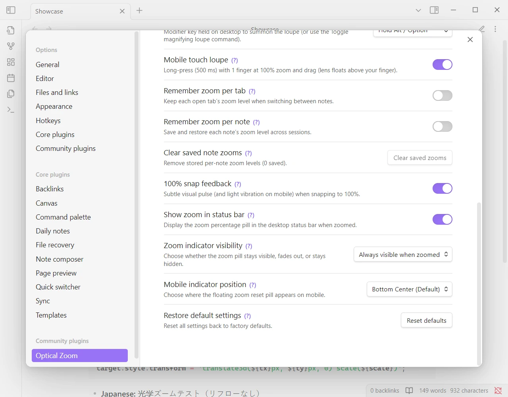

# Optical Zoom

A pinch-to-zoom & loupe magnifier plugin for Obsidian. True GPU-accelerated **optical** zoom for your notes **without text reflow** — pinch to magnify the whole rendered note, or hold a key / long-press to inspect a spot through a magnifying loupe — without ever changing your font size or reflowing lines.

Obsidian's built-in zoom changes font size and reflows text. This plugin instead scales the already-rendered note surface with a GPU transform (`translate3d(...) scale(...)`), so **zero text reflow** occurs and everything grows together in exact proportion:

- LaTeX / MathJax equations and subscripts
- Mermaid diagrams, SVG, tables, and embedded images
- Custom readable line-length CSS
- Dense CJK, Arabic, and Devanagari scripts

Works on **Windows, Linux, macOS, Android, and iOS/iPadOS** (`isDesktopOnly: false`).

## Demo & Screenshots



*(Also available as [WebM video](assets/optical-zoom-demo.webm).)*

| Desktop Optical Zoom (300%) | Hold-to-Loupe Magnifier |
| --- | --- |
|  |  |

| Mobile Touch Zoom | Settings (General & Loupe) | Settings (Triggers & Indicator) |
| --- | --- | --- |
|  |  |  |

## Features

- **Pinch-to-zoom around the focal point** — the exact character, formula, or pixel under your fingers/cursor stays put while everything scales around it (focal-point affine math, verified by unit tests).
- **Hold-to-loupe magnifier** — a snapshot lens magnifies one spot (1.5× / 2.0× / 2.5×) while the rest of the note stays at 100%. The snapshot is taken once when the lens opens; moving it is transform-only, so it stays smooth at 60/120 fps and canvas content (Excalidraw, charts) is copied across.
- **Free panning while zoomed** — drag the zoomed page around with one finger in any direction (Markor-style two-axis pan, ranged over the note's full scroll extent so no part of a long note is ever out of reach) or with two fingers. While zoomed, drags are shielded at the note container from the very first pixel so they never trigger Obsidian's side drawers by accident — but a deliberate fast flick inward from the very edge of the screen still opens a drawer, so the sidebars stay reachable without zooming back out.
- **Per-pane isolation** — every open note gets its own zoom controller (`WeakMap<WorkspaceLeaf, PaneZoomController>`), so pinching in one split never affects another, and controllers are cleaned up when tabs close.
- **Inner-sizer-only transforms** — only `.cm-sizer` (editor) and `.markdown-preview-sizer` (Reading view) are transformed. Scroll containers are never scaled, so scrollbars, wheel scrolling, and 1-finger scrolling keep working natively.
- **Magnetic snap & rubber band** — zooming out past 100% rubber-bands to a 0.92 floor during the gesture, and releasing anywhere in 96%–104% snaps cleanly back to exactly 100%.
- **Self-hiding zoom pill** — a status-bar pill on desktop (floating corner pill on mobile) appears only while zoomed ≠ 100%; click it to reset.
- **Zero popups** — no modals or floating toolbars. Even "Reset defaults" in Settings uses an inline tap-again-within-5-seconds confirmation.
- **(?) tooltips everywhere** — every setting and the zoom pill carries a plain-English explanation.
- **100% local** — zero network calls, zero telemetry, zero external dependencies at runtime.

## Install

### Upgrading from 1.1.x or earlier — the plugin ID changed

In 1.2.0 the plugin was renamed from "Optical Pinch-to-Zoom & Loupe Magnifier" (plugin ID `obsidian-optical-zoom`) to **Optical Zoom** (plugin ID `optical-zoom`), ahead of community-store publishing — Obsidian's guidelines don't allow "Obsidian" in plugin names or IDs. To upgrade:

1. Delete the old `obsidian-optical-zoom` folder from your vault's `.obsidian/plugins/` directory.
2. Install 1.2.0 into a new `optical-zoom/` folder (the zip below does this for you).
3. Re-enable **Optical Zoom** in **Settings → Community plugins**.

Heads-up: Obsidian stores plugin settings per plugin ID, so your settings will reset to defaults after the switch.

### Manual install — zip (easiest)

1. Download `optical-zoom.zip` from the [latest release](https://github.com/ViperSurf/obsidian-optical-zoom/releases/latest).
2. Unzip it into your vault's `.obsidian/plugins/` directory. The zip contains a ready-made `optical-zoom/` folder with everything inside — no folder to create by hand.
3. In Obsidian: **Settings → Community plugins**, turn off Restricted mode if needed, and enable **Optical Zoom**.

### Manual install — loose files

1. Download `main.js`, `manifest.json`, and `styles.css` from the [latest release](https://github.com/ViperSurf/obsidian-optical-zoom/releases/latest).
2. Create a folder named `optical-zoom` inside your vault's `.obsidian/plugins/` directory (`.obsidian/plugins/optical-zoom/`).
3. Copy the three files into that folder.
4. Enable the plugin as above.

### BRAT

You can also install and auto-update via the [BRAT](https://github.com/TfTHacker/obsidian42-brat) plugin by adding this repository: `ViperSurf/obsidian-optical-zoom`.

## Usage

| Action | How |
| --- | --- |
| Pinch zoom (touch) | Two-finger pinch in any note (Live Preview, Source, or Reading view) |
| Pinch zoom (trackpad) | Trackpad pinch, or `Ctrl`/`Cmd` + mouse wheel over the note |
| Pan while zoomed | Drag with one finger in any direction, drag with two fingers, or scroll — pan covers the note's full scroll extent, so every edge of a long note stays reachable and the note can't get lost off-screen |
| Open a side drawer while zoomed | Flick inward fast from the very edge of the screen (start within ~12 px of the left or right edge and swipe inward) — slow edge drags pan the page instead |
| Loupe (desktop) | Hold `Alt` (configurable: `Ctrl`, `Shift`, or disabled) and move the mouse — no click needed |
| Loupe (mobile) | Long-press (500 ms) with one finger **at 100% zoom** and drag; the lens floats 76 px above your thumb so it never covers what you're reading. While zoomed in, a held finger pans the page instead — the loupe never opens over already-magnified content |
| Reset to 100% | Press `Esc`, click the zoom pill, two-finger double-tap, or use the **Reset zoom to 100%** command |
| Zoom in / out (commands) | Use the **Zoom in** / **Zoom out** commands in the command palette (configurable step %, default 25%) |

Commands available in the palette (assign hotkeys in **Settings → Hotkeys**; no defaults are bound to avoid conflicts):

| Command | Recommended Hotkey |
| --- | --- |
| **Reset zoom to 100%** | `Ctrl`/`Cmd` + `0` |
| **Zoom in** | `Ctrl`/`Cmd` + `Shift` + `=` |
| **Zoom out** | `Ctrl`/`Cmd` + `Shift` + `-` |
| **Toggle magnifying loupe** | *(optional)* |
| **Toggle zoom lock** | *(optional)* |

## Settings

| Setting | Options | Default | What it does |
| --- | --- | --- | --- |
| Zoom interaction mode | Both / Pinch only / Loupe only | Both | Choose which magnification methods are active. |
| Zoom speed | 0.5× – 2.0× slider | 1.0× | Controls trackpad and touch pinch velocity. |
| Maximum magnification | 200% / 300% / 400% / 500% | 300% | Caps how far you can zoom into dense formulas, graphs, tables, or images. |
| Hotkey zoom step (%) | 5% – 50% slider | 25% | Step size used by Optical zoom in / out commands and hotkeys. |
| Pinch jitter stabilization | On / Off | On | Filters tiny finger-distance fluctuations so 2-finger panning stays steady. |
| Smooth pan momentum | On / Off | On | Adds gentle deceleration after releasing a fast 1-finger pan on touchscreens. |
| Reset zoom on Escape | On / Off | On | Pressing Escape while zoomed (with no modal/loupe open) resets to 100%. |
| Loupe lens size (px) | 140–400 px slider | 240 px | Diameter of the magnifying glass lens. |
| Loupe magnification power | 1.25×–4.0× | 2.0× | Optical zoom strength inside the magnifying glass. |
| Loupe lens shape | Rounded Rectangle / Circle | Rounded Rectangle | Chooses between rounded-square and circular loupe lens. |
| Desktop loupe key | Alt / Ctrl / Shift / Disabled | Alt | Modifier key held to summon the loupe on desktop. |
| Mobile touch loupe | On / Off | On | Long-press (500 ms) with 1 finger at 100% zoom and drag (offset above finger). |
| Remember zoom per tab | On / Off | Off | Keeps each tab's zoom level when switching notes. When off, switching tabs resets zoom to 100%. |
| Remember zoom per note | On / Off | Off | Persists zoom level per file path across sessions. |
| 100% snap feedback | On / Off | On | Subtle visual pulse (and light vibration on mobile) when snapping to 100%. |
| Show zoom in status bar | On / Off | On | Shows or hides the desktop status bar zoom pill while zoomed. |
| Zoom indicator visibility | Always / Auto-fade / Hidden | Always | Keeps the zoom pill visible, fades it out after zooming, or hides it. |
| Mobile indicator position | Bottom/Top Center, Left, or Right | Bottom Center | Places the floating mobile reset pill along the bottom or top edge. |

## Platform notes

- **Linux:** many X11/Wayland window managers intercept `Alt` + mouse drag to move windows. The desktop loupe is hover-only (hold the key, no click or drag), which avoids most conflicts — but if your WM still grabs `Alt`, switch the loupe key to `Ctrl` or `Shift` in Settings.
- **iOS/iPadOS:** the plugin coordinates Pointer Events with WebKit `GestureEvent` fallbacks and sets `touch-action: pan-x pan-y`, so two-finger pinch reaches the plugin while one-finger scrolling stays native.
- **Mobile:** Obsidian hides the desktop status bar on mobile, so the reset control appears as a small floating pill in the corner — only while zoomed.

## Privacy

This plugin is **100% local**:

- No network calls of any kind
- No telemetry, analytics, or tracking
- No external fonts, CDNs, or remote assets
- Settings are stored only in Obsidian's standard per-plugin `data.json` in your vault

## Development

Requires Node.js 20+.

```bash
npm install     # install dev dependencies (zero runtime dependencies)
npm run dev     # watch build
npm run build   # typecheck + production bundle -> main.js
npm run typecheck
npm test        # unit & controller integration tests (node:test)
npm run test:e2e # real Chromium mobile-touch & wheel E2E tests (Playwright)
```

The test suite bundles the real `src/math/affine-focal.ts` and `src/input/gesture-guards.ts` with esbuild (aliasing the types-only `obsidian` package to a small stub) and verifies: focal-point invariance within 0.01 px across 1.0× → 3.0× → 1.0×, magnetic snap inside [0.96, 1.04] only, the 0.92 rubber-band floor, max-scale clamping, pan clamping (including `tx = ty = 0` at scale ≤ 1), focal anchoring through the production client-to-focal conversion on scrolled notes (scroll offsets 0 / −800 / −1500 / −3000, with centered-column margins), pan reach for long notes at 2× and 3× (including bounds taken from the scroller's full scroll extent), and the gesture decisions (the > 1.005 zoom gate, the any-direction one-finger pan claim, edge-start zones at both container edges, and the deliberate drawer-flick classification).

### Releasing

Tag a version matching `manifest.json`'s `version` **without a `v` prefix** (e.g. `git tag 1.5.2 && git push origin 1.5.2`) — the release workflow builds the plugin and attaches `main.js`, `manifest.json`, and `styles.css` (required loose by the Obsidian community store / BRAT) plus `optical-zoom.zip`, a ready-to-unzip folder for manual installs.

## License

MIT © ViperSurf — see [LICENSE](LICENSE).
